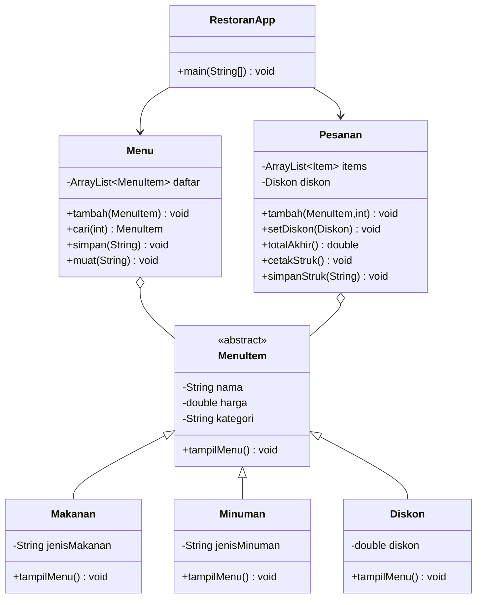

# Aplikasi Kasir Restoran

Aplikasi manajemen restoran berbasis Java (Console) untuk tugas Mata Kuliah Pemrograman Berbasis Desktop, Universitas Terbuka.

## Fitur

- **Menu Pelanggan (Pemesanan)**
  - Lihat daftar menu restoran
  - Pesan makanan/minuman dengan jumlah
  - Terapkan diskon (objek `Diskon`)
  - Promo otomatis: Beli 1 Gratis 1 minuman termurah jika total > Rp50.000 dan ada minuman
  - Diskon 10% jika total > Rp100.000
  - Cetak struk pembayaran (pajak 10% + biaya pelayanan Rp20.000)
  - Simpan struk ke file `struk.txt`
- **Manajemen Menu (Pemilik)**
  - Tambah menu baru (Makanan / Minuman / Diskon)
  - Ubah harga menu
  - Hapus menu
  - Simpan otomatis ke `menu.txt`
- **File I/O**
  - Muat dan simpan daftar menu dari/ke `menu.txt`
  - Simpan dan muat struk dari/ke `struk.txt`

## Struktur Proyek

```
Pemograman-Desktop/
├── README.md           # Dokumentasi ini
├── RestoranApp.java    # Entry point & UI utama
├── MenuItem.java       # Abstract class + 3 turunan (Makanan, Minuman, Diskon)
├── Menu.java           # Kelola daftar menu + file I/O menu.txt
├── Pesanan.java        # Catat pesanan, hitung total, cetak & simpan struk
├── menu.txt            # Data menu (dihasilkan otomatis)
└── struk.txt           # Struk terakhir (dihasilkan otomatis)
```

## Class Diagram



## Cara Menjalankan

### 1. Kompilasi
```bash
javac *.java
```

### 2. Jalankan
```bash
java RestoranApp
```

### 3. Menu Utama
```
1. Menu Pelanggan (Pemesanan)
2. Manajemen Menu (Pemilik)
3. Keluar
```

## Format File `menu.txt`

Setiap baris mewakili satu item menu, dipisahkan dengan `|`:

| Tipe | Format | Contoh |
|------|--------|--------|
| Makanan | `MAKANAN|nama|harga|jenis` | `MAKANAN|Nasi Goreng|25000|Goreng` |
| Minuman | `MINUMAN|nama|harga|jenis` | `MINUMAN|Es Teh|5000|Es` |
| Diskon | `DISKON|nama|persen` | `DISKON|Diskon 10%|10` |

**Catatan:** Jika Anda menambah item secara manual di `menu.txt`, program akan membacanya saat **dijalankan ulang**.

## Alur Program

```
Start
  │
  ▼
Muat menu.txt (atau isi default jika kosong)
  │
  ▼
┌─ Menu Utama ──┐
│ 1. Pelanggan  │──► Tampil menu ──► Pilih item & jumlah ──► Terapkan diskon?
│ 2. Pemilik    │──► Tambah/Ubah/Hapus menu ──► Simpan menu.txt
│ 3. Keluar     │──► Simpan menu.txt ──► Selesai
└───────────────┘
  │
  ▼
Pesanan selesai ──► Cetak struk ──► Simpan struk.txt
```

## Persyaratan

- Java JDK 8 atau lebih baru
- Tidak perlu library eksternal (hanya menggunakan Java Standard Library)

## Catatan

- Semua atribut kelas menggunakan `private` (encapsulation) dengan getter/setter.
- `MenuItem` adalah `abstract class` dengan method abstract `tampilMenu()`.
- Inheritance diterapkan: `Makanan`, `Minuman`, dan `Diskon` mewarisi `MenuItem`.
- Exception ditangani untuk input tidak valid dan item menu yang tidak ditemukan.
